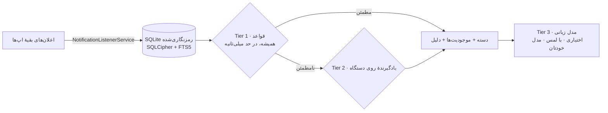

# الک · Alak

نام پروژه از واژهٔ فارسی **الک** می‌آید — توریِ ریزِ آشپزخانه؛ چیزی که نرمه را از درشت جدا می‌کند.

کل محصول در همین یک واژه است: سینی اعلان‌های شما پر از نویز است؛ الک آن را الک می‌کند.

*نویز را الک کن.*

[README English](README.md) · مستندات کامل انگلیسی

---

**الک یک سازمان‌دهندهٔ اعلان، آفلاین و روی خودِ دستگاه، برای اندروید است.** اعلان‌هایی که به آن اجازه
می‌دهید را می‌خواند، هر کدام را با یک موتور قاعده‌محورِ سریع و *توضیح‌پذیر* دسته‌بندی می‌کند، چیزهایی
را که وگرنه از دست می‌روید استخراج می‌کند — کد تخفیف، مبلغ، تاریخ، لینک — از تصحیح‌های شما روی خود
گوشی یاد می‌گیرد و (کاملاً اختیاری) با یک مدل زبانی کوچک که خودتان نصب کرده‌اید خلاصه و توضیح می‌سازد.

بدون حساب کاربری. بدون ابر. بدون تلمتری. اپ هرگز مجوز `INTERNET` نمی‌خواهد — و CI هر تغییری که بخواهد
چنین مجوزی اضافه کند را رد می‌کند.

> **وضعیت:** در حال توسعه به سوی نسخهٔ ۱٫۰ — هم‌اکنون در مایلستون **۸ از ۱۱**.
> جزئیات: [`docs/progress.md`](docs/progress.md).

## چرا الک؟

هر روز صدها اعلان می‌گیریم: تبلیغ، کد تخفیف، ایمیل کاری، چت، پیام بانک، وضعیت مرسوله، رمز یک‌بارمصرف.
سینی اعلان اندروید یک انبار **فرّار** است: به‌محض این‌که اعلان را بکشید و دور بیندازید، برای همیشه
رفته است. این برای کدهای تخفیف که عمداً با فوریت («تا امشب!») فرستاده می‌شوند دردناک‌تر است.
تاریخچهٔ داخلی اندروید هم فقط یک فهرست زمانیِ ساده است — نه دسته‌بندی، نه استخراج، نه کیف پول کد.

الک این تاریخچه را **قابل‌جست‌وجو، دسته‌بندی‌شده و مفید** می‌کند — بدون این‌که حتی یک بایت از گوشی
بیرون برود.

## چه‌کار می‌کند؟

- **ضبط** — خواندن اعلان‌ها از طریق `NotificationListenerService`، اکیداً فقط‌خواندنی؛ انتخاب دقیق
  این‌که کدام اپ‌ها ضبط شوند و چه مقدار از محتوایشان نگه داشته شود.
- **دسته‌بندی** — موتور قواعد (Tier 1) هر اعلان را در یکی از نه دسته می‌گذارد: پیشنهادها، کار،
  افراد، پول، سفارش‌ها، امنیت، شبکه‌های اجتماعی، به‌روزرسانی‌ها، سایر — به‌علاوهٔ **کیف پول کدها**.
  اولویت تعارض‌ها ایمن‌محور است: `security > money > work > orders > people > offers > social > updates > other`.
- **استخراج** — کد تخفیف با تاریخ انقضا، تخفیف‌ها، مبالغ (واحد پول و مقیاس‌هایی مثل هزار/میلیون)،
  تاریخ میلادی **و شمسی**، لینک‌ها، و پین سفر (که عمداً رمز یک‌بارمصرف حساب نمی‌شود).
- **توضیح** — هر تصمیم خودکار یک «چرا»ی قابل‌فهم دارد؛ هیچ چیز جعبهٔ سیاه نیست.
- **یادگیری** — یک بار دستهٔ اشتباه را اصلاح کنید، Tier 2 روی خود گوشی یاد می‌گیرد و دفعهٔ بعد
  درست انجام می‌دهد.
- **خلاصه‌سازی (اختیاری)** — Tier 3: فقط با لمس دکمه، با مدلی که **خودتان وارد کرده‌اید**. هرگز
  زمان‌بندی‌شده و در پس‌زمینه اجرا نمی‌شود.

## حریم خصوصی، در ساختِ محصول

- بدون مجوز `INTERNET` و `ACCESS_NETWORK_STATE` — با جاب `privacy-guard` در CI تضمین می‌شود.
- بدون هیچ HTTP client، SDK تحلیلی، تبلیغاتی یا گزارش خرابی.
- پایگاه‌دادهٔ SQLite با **SQLCipher** رمزنگاری می‌شود؛ قواعد نگهداری خودکار آن را مرتب نگه می‌دارند.
- محتوای OTP/دوعاملی **هرگز** ذخیره نمی‌شود — سیاستِ تحمل‌ناپذیریِ صفر، با تست corpus اثبات می‌شود.
- اپ‌های چت به‌طور پیش‌فرض فقط «فرستنده + زمان» نگه می‌دارند.
- پک‌های زبان صرفاً **داده**‌اند؛ هیچ چیزی که از پک بارگذاری شود نمی‌تواند کد اجرا کند.

جزئیات کامل: [`docs/PRIVACY.md`](docs/PRIVACY.md).

## دو خط، یک محصول

انگلیسی (LTR) و فارسی (RTL) شهروند درجه‌یک هستند، نه ترجمهٔ اضافه‌شده:

- ارقام فارسی و **تاریخ جلالی** به‌عنوان پیش‌فرض در رابط فارسی (هر دو قابل تغییر)، با تست جدول طلایی
  تقویم (سال‌های ۱۴۰۰ تا ۱۴۲۰).
- ممیزی کامل RTL و نرمال‌سازی متن عربی‌خط.
- پک توسعه‌ای **فینگلیش** (`fa-latn`) با قواعد فعال‌سازی سخت‌گیرانه تا دقت انگلیسی را خراب نکند.
- قلم [Vazirmatn](https://github.com/rastikerdar/vazirmatn) برای رابط فارسی.

زبان‌های بیشتر از طریق **پک‌های زبان**ِ همگانی اضافه می‌شوند — فقط فایل داده، بدون هیچ کدی.

راهنمای ساخت پک: [`docs/contributing/CONTRIBUTING.md`](docs/contributing/CONTRIBUTING.md)
و قالب آماده: [`packs/_template/`](packs/_template).

## معماری در یک نگاه

معماری کامل: [`docs/ARCHITECTURE.md`](docs/ARCHITECTURE.md) · ساخت و تست: [`docs/BUILD.md`](docs/BUILD.md).

## فناوری

- **.NET 10** و **.NET MAUI** (`net10.0-android36.0`) — فقط اندروید (iOS اصلاً امکان خواندن اعلان
  بقیهٔ اپ‌ها را ندارد).
- xUnit + Shouldly برای تست‌ها؛ حدود ۹۰۰ تست سبز در ۶ سویییت.
- موتور پیشنهادی مدل: llama.cpp از طریق یک shim بومی، پشت قرارداد `IInferenceEngine`.

## وضعیت پروژه

| مایلستون | دامنه | وضعیت |
|---|---|---|
| M1 | تست ضبط اعلان روی دستگاه واقعی | ✅ انجام شد |
| M2 | ذخیره‌سازی رمزنگاری‌شده، FTS دوزبانه | ✅ انجام شد |
| M3 | هستهٔ موتور قواعد + پک انگلیسی | ✅ انجام شد |
| M4 | پک فارسی، جلالی/RTL، پک فینگلیش | ✅ انجام شد |
| M5 | پوستهٔ اپ MAUI + سیستم طراحی | ✅ انجام شد |
| M6 | Onboarding، منابع، قواعد، تنظیمات | ✅ انجام شد |
| M7 | کیف پول کدها + Tier 2 | ✅ تقریباً کامل (پشتیبان‌گیری/بازیابی مانده) |
| M8 | راه‌اندازی روی دستگاه + تصمیم موتور AI | 🚧 در جریان — اپ بالا می‌آید و رندر می‌شود |
| M9 | قابلیت‌های مدل زبانی | ⏳ در انتظار |
| M10 | سخت‌سازی corpus، دسترس‌پذیری | ⏳ در انتظار |
| M11 | کاندید انتشار — بیلد امضاشده، استورها | ⏳ در انتظار |

## نقشهٔ مستندات

| سند | موضوع |
|---|---|
| [`docs/spec/SPEC.md`](docs/spec/SPEC.md) | **سند مرجع** — نیازمندی‌ها با شناسه، ثبت تصمیم‌ها |
| [`docs/ARCHITECTURE.md`](docs/ARCHITECTURE.md) | لایه‌بندی، خط پردازش، راهنمای هر پروژه |
| [`docs/PRIVACY.md`](docs/PRIVACY.md) | مدل حریم خصوصی و امنیت |
| [`docs/BUILD.md`](docs/BUILD.md) | پیش‌نیازها، دستورهای ساخت و تست |
| [`docs/contributing/CONTRIBUTING.md`](docs/contributing/CONTRIBUTING.md) | قواعد مشارکت + شروع سریع پک زبان |
| [`docs/adr/`](docs/adr) | رکوردهای تصمیم معماری (ADR) |
| [`docs/verification.md`](docs/verification.md) | لاگ راستی‌آزمایی روی دستگاه |
| [`docs/progress.md`](docs/progress.md) | لاگ پیشرفت |

## مجوز

- **کد**: [GPL-3.0-or-later](LICENSE) — تا فورک‌های بسته و پر از ردیاب از یک اپ حریم‌خصوصی جلوگیری شود.
- **پک‌های زبان و corpus**: [CC0-1.0](LICENSE-DATA).
- وزن‌های مدل **هرگز** همراه اپ توزیع نمی‌شوند — کاربر خودش مدل را انتخاب و وارد می‌کند.

---

*«الک» نام رمز پروژه است؛ پیش از انتشار عمومی، آزاد بودن نام بررسی می‌شود (تصمیم D-01 سند مشخصات)
و نام در هیچ‌جای کد hard-code نشده است.*
