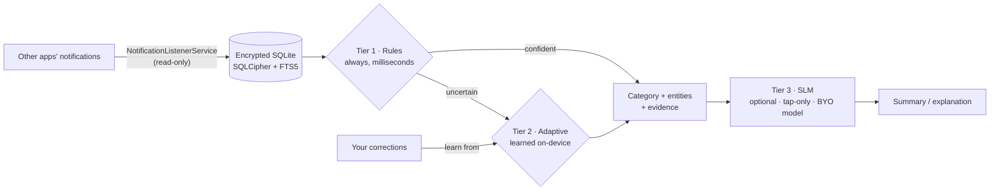

<div align="center">

# Alak · الک

**الک** (*ālak*) is Persian for **sieve** — the fine mesh that keeps what matters and lets the rest fall through.

That is the whole product in one word: your notification shade is noise; Alak sifts it.

*Sift the noise.*

English · [فارسی](README.fa.md)

[](https://github.com/SudoScraTchY/Alak/actions/workflows/ci.yml)


</div>

---

**Alak is an offline, on-device notification organizer for Android.** It captures the notifications
you allow it to read, sorts each one into a category with a fast, explainable rule engine, extracts
the facts you would otherwise lose — promo codes, amounts, dates, links — learns from your
corrections on-device, and (entirely optionally) summarizes and explains with a small language model
that you install yourself.

No account. No cloud. No telemetry. The app never requests the `INTERNET` permission, and CI fails
any change that would add one.

> **Status: in active development** toward v1.0 — currently at **M8 of 11 milestones**
> (the app builds, installs and renders its full UI on a device/emulator; verified 2026-10-10).
> See [Project status](#project-status) and `docs/progress.md`.

## Why

People receive hundreds of notifications a day — ads, promo codes, work email, chat, bank alerts,
delivery updates, one-time passwords. Android's notification shade is a **volatile store**: the
moment a notification is swiped away or cleared, it is gone. That is especially painful for promo
codes, which arrive as push notifications designed to create urgency ("ends tonight!"). Android's
built-in notification history is a flat, chronological list — no categories, no extraction, no code
handling.

Alak makes that history **searchable, organized and useful** — without ever sending a byte off the
phone.

## What it does

- **Capture** — reads notifications via Android's `NotificationListenerService`, strictly
  read-only: Alak never dismisses, replies to or acts on other apps' notifications. You choose
  *which apps* are captured and *how much* of each notification is kept.
- **Categorize** — a Tier-1 rule engine (Aho-Corasick concept matching + log-odds scoring) sorts
  every notification into one of nine categories — Offers, Work, People, Money, Orders, Security,
  Social, Updates, Other — with a derived **Codes wallet** for promo codes. Conflicts resolve
  safety-first: `security > money > work > orders > people > offers > social > updates > other`.
- **Extract** — structured facts from the text: promo codes with expiry, discounts, money amounts
  (named currencies, scale words like *هزار/میلیون*), dates (Gregorian **and Jalali**), links, ride
  PINs (which are deliberately *not* treated as security OTPs).
- **Explain** — every automatic decision carries a human-readable reason. Nothing is a black box.
- **Learn** — correct a wrong category once and a tiny Tier-2 on-device learner gets it right next
  time.
- **Summarize (optional)** — Tier 3: tap a button to run a small language model **you imported** for
  a summary or explanation. User-triggered only — never scheduled, never in the background.
- **Codes wallet** — saved promo codes with expiry tracking, one-tap copy and local reminders.

## Privacy by construction

Privacy is **verifiable, not promised**:

- No `INTERNET` and no `ACCESS_NETWORK_STATE` permission — enforced by a CI `privacy-guard` job
  that greps every manifest, project file and source file on every pull request.
- No HTTP client, analytics SDK, ad SDK or crash reporter anywhere in the dependency tree.
- Storage is an **SQLCipher-encrypted** SQLite database with full-text search; retention rules prune
  it automatically.
- OTP / 2FA content is **never persisted** — a zero-tolerance policy proven by corpus tests.
- Chat apps default to *sender + time only* until you opt in to more.
- Language packs and model catalogs are **data only**: nothing loaded from a pack can execute code.

Full model, threat reasoning and verification status: [`docs/PRIVACY.md`](docs/PRIVACY.md).

## Two scripts, one product

English (LTR) and Persian (RTL) are first-class citizens, not translations bolted on:

- Persian digits and **Jalali dates** everywhere when the UI language is Persian (both toggleable),
  backed by a golden-table calendar test (years 1400–1420).
- Full RTL layout audit and text normalization for Arabic-script text.
- An experimental **Finglish** (Persian-in-Latin-script) *extension pack* with strict activation
  rules so it can never degrade English precision.
- Bundled fonts: [Vazirmatn](https://github.com/rastikerdar/vazirmatn) for Persian UI,
  JetBrains Mono for code-like content.

More languages arrive as community **language packs** — pure data files, no code required.

## How it works



Rules and a tiny learned model handle ~99% of the work in milliseconds. The language model is an
enhancement you opt into, never a dependency. Details: [`docs/ARCHITECTURE.md`](docs/ARCHITECTURE.md).

## Repository tour

```
Alak.slnx                .NET 10 solution (8 src projects, 6 test projects)
├─ src/
│  ├─ Alak.Core/                    domain model: notifications, categories, entities, evidence
│  ├─ Alak.Text/                    normalization, script/language detection, Jalali calendar
│  ├─ Alak.Rules/                   Tier-1 engine: matcher, scoring, extractors, user rules
│  ├─ Alak.Storage/                 SQLCipher SQLite, FTS5, migrations, retention
│  ├─ Alak.Adaptive/                Tier-2 on-device learner
│  ├─ Alak.Inference.Abstractions/  Tier-3 contracts (IInferenceEngine, bounded tasks)
│  ├─ Alak.App/                     the MAUI Android app (5 tabs: Inbox, Scan, Codes, Rules, Settings)
│  └─ Alak.Packs.Tool/              `alak-pack` CLI: validate · test · coverage · lint · bundle · new
├─ packs/                 language packs: en, fa, fa-latn (Finglish), _template
├─ tests/corpus/          bilingual evaluation corpora + deterministic generators
├─ tools/Alak.CorpusEval/ metric harness: macro-F1, promo P/R, OTP recall
├─ docs/                  spec, ADRs, architecture, privacy, build, verification, progress
└─ .github/workflows/     CI: unit-tests + privacy-guard
```

App identity: `com.alak.app`, minSdk 24, target API 36. Built with **.NET 10** and **.NET MAUI**
(`net10.0-android36.0`); xUnit + Shouldly for tests; CommunityToolkit.Mvvm in the app layer.

## Build & test

```bash
# prerequisites: .NET SDK 10 (pinned via global.json), MAUI android workload, JDK 17+
dotnet restore Alak.slnx
dotnet build Alak.slnx -c Release
dotnet test   Alak.slnx          # or: dotnet run --project tests/Alak.Rules.Tests
```

Full prerequisites, per-suite commands, the `alak-pack` and `CorpusEval` tools, device notes and
project conventions live in [`docs/BUILD.md`](docs/BUILD.md).

## Language packs

A pack is a **folder of JSON data files** — no C#, nothing executable:

```
packs/<id>/   pack.json · lexicon.json · numbers.json · dates.json · patterns.json · apps.json · tests/*.yaml
```

Every term needs test cases (positive *and* negative), and the CLI gates everything:

```bash
dotnet run --project src/Alak.Packs.Tool -- new <id>       # scaffold from the template
dotnet run --project src/Alak.Packs.Tool -- validate packs/<id>
dotnet run --project src/Alak.Packs.Tool -- test packs/<id>
dotnet run --project src/Alak.Packs.Tool -- bundle packs/<id>   # → .alakpack + SHA-256
```

Start from [`packs/_template/`](packs/_template) and follow the guide in
[`docs/contributing/CONTRIBUTING.md`](docs/contributing/CONTRIBUTING.md) — "add a language in an
afternoon" is a design goal. Pack license: **CC0-1.0**.

## AI models — your choice, your file

Alak ships **no model weights**. The app has no downloader (that would need the INTERNET
permission); instead the Models screen lists curated options with "open in browser" links, and you
import the model file yourself via the Android file picker. The app verifies hashes, measures speed,
and only ever runs the model when you tap the button. The runtime sits behind
`IInferenceEngine` (provisional engine: llama.cpp via a native shim), so several runtimes can
coexist. Rationale: spec decision D-03/D-04.

## Project status

| Milestone | Scope | State |
|---|---|---|
| M1 | Notification capture spike on real devices | ✅ done |
| M2 | Encrypted storage, bilingual FTS, retention | ✅ done |
| M3 | Rule-engine core + English pack + corpus gates | ✅ done |
| M4 | Persian pack, Jalali/RTL, Finglish extension pack | ✅ done |
| M5 | MAUI app shell + design system | ✅ done |
| M6 | Onboarding, Sources, Rules, Settings | ✅ done |
| M7 | Codes wallet + adaptive Tier 2 | ✅ mostly done (backup/restore pending) |
| M8 | On-device bring-up + AI runtime decision (ADR) | 🚧 in progress — app boots & renders |
| M9 | SLM features (summaries, digests) | ⏳ pending |
| M10 | Corpus hardening, accessibility, privacy pass | ⏳ pending |
| M11 | Release candidate — signed builds, stores | ⏳ pending |

*As of the latest handoff (2026-10-10). Live log: `docs/progress.md` and `docs/AGENT-HANDOFF.md`.*

## Documentation map

| Document | What it is |
|---|---|
| [`docs/spec/SPEC.md`](docs/spec/SPEC.md) | **The** specification — requirements with IDs, decisions register, the source of truth (~1,600 lines) |
| [`docs/ARCHITECTURE.md`](docs/ARCHITECTURE.md) | Layering, pipeline and per-project guide |
| [`docs/PRIVACY.md`](docs/PRIVACY.md) | The privacy & security model and how "no network" is enforced |
| [`docs/BUILD.md`](docs/BUILD.md) | Prerequisites, build/test commands, tooling, conventions |
| [`docs/contributing/CONTRIBUTING.md`](docs/contributing/CONTRIBUTING.md) | Contribution rules + language-pack quick start |
| [`docs/adr/`](docs/adr) | Architecture decision records |
| [`docs/verification.md`](docs/verification.md) | Platform & on-device verification log (PF-xx items) |
| [`docs/progress.md`](docs/progress.md) | Dated implementation progress log |
| [`docs/HANDOFF-STATUS.md`](docs/HANDOFF-STATUS.md) · [`docs/AGENT-HANDOFF.md`](docs/AGENT-HANDOFF.md) · [`docs/GOAL-PROMPTS.md`](docs/GOAL-PROMPTS.md) | Agent-session state dumps — this repo is built spec-first with AI coding agents |

## Contributing

Two paths, both designed in from day one:

1. **Code** (C#/.NET) — build with zero warnings, tests green, reference requirement IDs
   (`CAP-xxx`, `RUL-xxx`, …) in commits, tests and PRs. Rules: [`docs/contributing/CONTRIBUTING.md`](docs/contributing/CONTRIBUTING.md).
2. **Language packs** (data only) — copy the template, add terms + tests, run `alak-pack`.
   Issue templates exist for [language requests](.github/ISSUE_TEMPLATE/language_request.md) and
   [pack contributions](.github/ISSUE_TEMPLATE/pack_contribution.md).

Ground rules that make Alak what it is: **no network capability, ever** · data-only extensibility ·
every automatic decision explains itself · rules are test-first · no guessed identifiers.

## License

- **Code** (`src/`, `tests/`, `tools/`, app): [GPL-3.0-or-later](LICENSE) — chosen to keep tracker-laden
  closed forks of a privacy app at bay.
- **Language packs, corpora, model catalogs** (`packs/`, `tests/corpus/`): [CC0-1.0](LICENSE-DATA).
- Model weights are **never** distributed with the app — users bring their own.

---

*Alak* (الک) is a working codename — availability will be checked before any public store release
(spec decision D-01), and the name is never hard-coded in the app.
