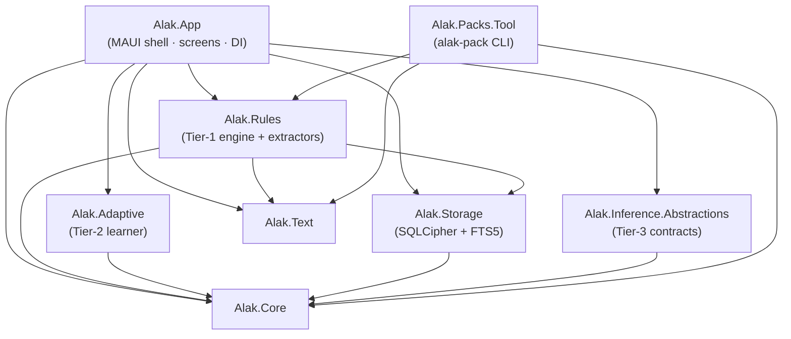

# Alak — Architecture

This is the *how it is built* companion to [`docs/spec/SPEC.md`](spec/SPEC.md) (the *what it must
do*). Everything here is derived from the spec and the code as it actually stands; where the spec
and reality could drift, the code wins and this file gets updated.

## 1. The mental model

One pipeline, three tiers, one iron rule: **no network, ever.**

1. Android hands other apps' notifications to Alak via `NotificationListenerService` (read-only).
2. Every captured row lands in an **SQLCipher-encrypted** SQLite database with bilingual full-text
   search (FTS5) and retention rules.
3. **Tier 1 — Rules** (always, milliseconds): a compiled rule engine categorizes and extracts.
   ~99% of traffic ends here.
4. **Tier 2 — Adaptive** (on-device): the user's corrections train a tiny local model that swings
   uncertain cases.
5. **Tier 3 — SLM** (optional, tap-only): a user-imported small language model explains or
   summarizes a specific item. Never scheduled, never background.

Every automatic decision carries human-readable **evidence** — category, entities, tags and a
"why" the UI can render (spec R4 / RUL-020).

## 2. Project layering

The dependency direction is a hard convention (spec §5.2, ADR-0001): *domain and text layers know
nothing about Android or storage; storage never reaches up into rules; the app references
everything.* Verified against the `.csproj` `ProjectReference` graph:

- **Leaf layers** (`Alak.Core`, `Alak.Text`): platform-neutral, no package deps beyond BCL.
- **Service layers** (`Alak.Storage`, `Alak.Adaptive`, `Alak.Inference.Abstractions`): depend only
  on `Alak.Core`.
- **Engine** (`Alak.Rules`): depends on `Text` + `Core` + `Storage` (rule persistence).
- **App** (`Alak.App`): the only project that sees Android/MAUI.

Test projects mirror `src/` one-to-one (`tests/Alak.*.Tests`), plus `tests/Diagnostics` (scratch
console, not part of the solution) and `tests/corpus/` (evaluation data + deterministic generators).

## 3. The projects

| Project | Contains | Notes |
|---|---|---|
| `Alak.Core` | `RawNotification` (capture), `Notification`, `Category` (9 categories + conflict priority), `Entity`, `Tag`, `Evidence`, `UserRule`, `IClock` | `IClock` is the *only* way to get time (ARC-003); `DateTime.Now` in logic is a review reject |
| `Alak.Text` | `Normalization` (NRM-001..010), `ScriptLanguage` (script/language detection), `JalaliCalendar` (Borkowski/Khayyam 33-year cycle, golden-table tested 1400–1420) | Powers both EN and FA text paths |
| `Alak.Rules` | `ConceptMatcher` (Aho-Corasick over all enabled packs, word-boundary enforced), `RuleCompiler` (pack YAML/JSON → in-memory rules, `RegexOptions.NonBacktracking` only), `RulesEngine` (log-odds scoring, spec §8.8, with app-prior feature), `UserRulesEngine` (user overrides win on next match), `Extraction/` (promo codes, money + named currencies + scale words, datetime, discounts, OTP with ride-pin suppression) | The "feels like AI" tier |
| `Alak.Storage` | `NotificationStore` / `NotificationRepository` (schema v1, migrations, keyset pagination, retention), `PromoCodeRepository` (codes wallet), `UserRulesRepository`, SQLCipher via `SQLitePCLRaw.bundle.sqlcipher`, FTS5 over both languages | PF-10 (SQLCipher + FTS5 + Persian queries) verified by desktop integration test |
| `Alak.Adaptive` | `IAdaptiveEngine` + `AdaptiveEngine` — on-device learner over user corrections (spec §10) | Deliberately tiny; must stay cheap |
| `Alak.Inference.Abstractions` | `IInferenceEngine`, bounded tasks (`ExplainTask`, review/digest/code-details), `JsonValidator` (constrained outputs), `InferenceEngineStub` + `FakeInferenceEngine` | No concrete runtime in the abstraction; engines plug in (llama.cpp shim planned, `native/llama-shim`) |
| `Alak.App` | MAUI shell: 5 tabs (Inbox / Scan / Codes / Rules / Settings), ViewModels (MVVM Toolkit, DI-injected), design tokens as XAML dictionaries (`Colors`, `Controls`, `Shapes`, `Typography`), `ThemeManager` (light/dark) | `net10.0-android36.0`; app id `com.alak.app` |
| `Alak.Packs.Tool` | The `alak-pack` CLI: `validate` · `test` · `coverage` · `lint` · `bundle` · `new` | Also produces `.alakpack` bundles + SHA-256 |
| `Alak.CorpusEval` (tools/) | QLT-003 metric harness: per-category P/R/F1, macro-F1, promo precision/recall, OTP recall | The gate every rule/pack change must survive |

## 4. The rule engine (Tier 1), briefly

1. **Normalize** — Unicode, digits (Persian ↔ Latin), Arabic-script forms (NRM-xxx).
2. **Detect** — script + language detection chooses which packs are live.
3. **Match concepts** — one Aho-Corasick automaton over every enabled pack's lexicon, rebuilt
   atomically on pack change; word boundaries enforced (a bare `address` must not hit `ad.marker`).
4. **Score** — log-odds scoring per spec §8.8 with an app-prior feature
   (λ·log((n_c+α)/(N+9α)), α=1, λ=0.6, clamped ±1.5) plus channel/work/calendar evidence.
5. **Resolve conflicts** — safety-first priority:
   `security > money > work > orders > people > offers > social > updates > other`.
   Deliberate overrides: ride PINs are *not* OTPs; weak anchors don't create promo codes.
6. **Extract** — entities (promo code, money, datetime, discount, link) attach to the row with
   evidence.
7. **Budget** — Tier-1 work is latency-budgeted (RUL-002) and perf-tested in Release.

Every rule concept has positive *and* negative corpus cases (R5); the corpus lives in
`tests/corpus/{en,fa,fa-latn}` (hand-written worked examples + deterministic generated + adversarial
sets) and `Alak.CorpusEval` enforces the QLT-003 gates (macro-F1, promo P/R, OTP recall).

## 5. Storage shape

- Schema v1 with numbered migrations; keyset pagination for large inboxes; retention pruning.
- FTS5 virtual tables queried in both English and Persian.
- Encrypted at rest via SQLCipher (`bundle_e_sqlcipher`).
- Sensitive-content guard: OTP content is never persisted (corpus-tested, zero tolerance).
- Per-app capture depth (spec §6.5): chat apps default to *sender + time only* until opted in.

## 6. Inference (Tier 3) contract

`IInferenceEngine` exposes **bounded tasks** — explain-a-notification, digest, code details — not
open chat. Outputs are JSON and validated (`JsonValidator`) before the UI trusts them. Engines are
imported by the user as model files (spec D-03: import-only, no in-app download, hence no INTERNET
permission) and run only on an explicit user action (D-08). The provisional engine is llama.cpp via
a C shim (`native/llama-shim`); the decision gate with measured numbers is M8's ADR (spec §9.4).

## 7. Language packs

Data-only, versioned by `schemaVersion: 1`: `pack.json` (manifest), `lexicon.json` (concept →
terms), `numbers.json`, `dates.json`, `patterns.json` (regex signal/pattern rules — must compile
with `RegexOptions.NonBacktracking`, size caps per PCK-004), optional `apps.json`, and a mandatory
`tests/` suite. Packs never inject UI text — they reference app-owned explanation templates by key.
Bundled artifacts are `.alakpack` files with a recorded SHA-256.

`fa-latn` (Finglish) is an **extension pack**: it activates only on Finglish-only hits, and a
structural test proves its terms never overlap English ones and that English classification is
bit-identical with and without it.

## 8. CI

`.github/workflows/ci.yml`, two jobs on every push/PR:

1. **unit-tests** — restore, build (`-c Release`), test the whole solution on a desktop runner
   (ARC-001: no emulator needed for >90% of tests).
2. **privacy-guard** (OSS-004 / R2) — fails the build if any manifest or `.csproj` declares
   `INTERNET` / `ACCESS_NETWORK_STATE` / `QUERY_ALL_PACKAGES` / `READ_EXTERNAL_STORAGE`, if any
   analytics/ad/crash SDK appears in a project file, or if any C# source contains a network client
   (`System.Net`, `HttpClient`, `WebClient`, raw sockets).

## 9. Conventions that shape the architecture

- Requirement IDs (`CAP-xxx`, `RUL-xxx`, `PF-xx`, …) in commits, tests and PRs (spec §0.2).
- VERIFY items get a row in [`verification.md`](verification.md) when actually checked, or a
  `TODO(verify)` — nothing is assumed about platforms (R1, R8).
- Decisions get ADRs in [`adr/`](adr/).
- Package versions live in each `.csproj`, never in `Directory.Build.props` (ADR-0001).
